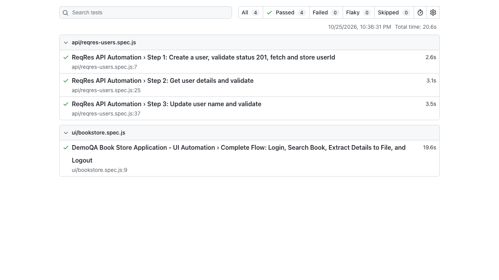

# Playwright QA Automation Framework

Comprehensive end-to-end test automation suite built with **Playwright** and **JavaScript**, covering both UI workflow validation on **DemoQA** and REST API lifecycle validation on **ReqRes**.

---

## Test Execution Report



> **All 4 Test Cases Passing (1 UI + 3 API)** in **20.6s** with zero flaky or skipped tests.

---

## Architecture & Tech Stack

* **Framework:** Playwright (`@playwright/test`)
* **Language:** JavaScript (Node.js)
* **Design Pattern:** Page Object Model (POM) for UI modularity and maintainability
* **Assertion Engine:** Playwright Web-First Assertions (`expect`)
* **Reporting:** Playwright Built-in HTML Reporter with execution traces and screenshots

---

## Project Structure

```
playwright-qa-automation/
├── assets/
│   └── test-report.png        # Test execution report screenshot
├── pages/                     # Page Object Model (POM)
│   ├── LoginPage.js           # Login, session validation, and logout
│   └── BookStorePage.js       # Book store navigation, search, and data extraction
├── tests/
│   ├── ui/
│   │   └── bookstore.spec.js  # UI E2E test suite
│   └── api/
│       └── reqres-users.spec.js # API REST lifecycle test suite (POST, GET, PUT)
├── test-data/
│   └── testData.json          # Test credentials and search terms
├── output/
│   └── book-details.txt       # Extracted Title, Author, Publisher output
├── playwright.config.js       # Playwright runner and HTML reporting configuration
├── package.json               # Dependencies and test execution scripts
└── .gitignore                 # Excludes node_modules and generated reports
```

---

## Implemented Test Scenarios

### Part 1: UI Automation (`https://demoqa.com/`)
1. **Navigate to Login:** Opens DemoQA Login page.
2. **Authenticate:** Logs in using registered credentials.
3. **Session Validation:** Asserts that the logged-in username is displayed and the **Log out** button is visible.
4. **Book Store Navigation:** Clicks the Book Store button and handles page navigation.
5. **Search:** Searches for `"Learning JavaScript Design Patterns"`.
6. **Result Validation:** Asserts that the search result contains the expected book.
7. **Data Extraction:** Extracts **Title**, **Author**, and **Publisher** and saves them into `output/book-details.txt`.
8. **Logout:** Clicks **Log out** and verifies clean session redirection.

### Part 2: API Automation (`https://reqres.in/`)
1. **Create User (`POST /api/users`):** Creates user, validates `201 Created` status code, and captures generated `userId`.
2. **Get User (`GET /api/users/{id}`):** Validates `200 OK` status and user details schema (`id`, `email`, `first_name`).
3. **Update User (`PUT /api/users/{id}`):** Updates user name, validates `200 OK` status, and validates updated payload fields and `updatedAt` timestamp.

---

## Getting Started

### 1. Prerequisites
* **Node.js** (v18 or higher recommended)
* **npm**

### 2. Installation
```bash
git clone <your-repository-url>
cd playwright-qa-automation
npm install
npx playwright install chromium
```

### 3. Running Tests

#### Run All Tests (UI + API):
```bash
npm test
```

#### Run UI Tests in Headed Mode (Watch browser live):
```bash
npm run test:ui:headed
```

#### Run API Tests Only:
```bash
npm run test:api
```

#### View HTML Test Report:
```bash
npm run report
```

---

## Output Artifact (`output/book-details.txt`)

Generated automatically upon executing the UI test suite:
```
Title: Learning JavaScript Design Patterns
Author: Addy Osmani
Publisher: O'Reilly Media
```
